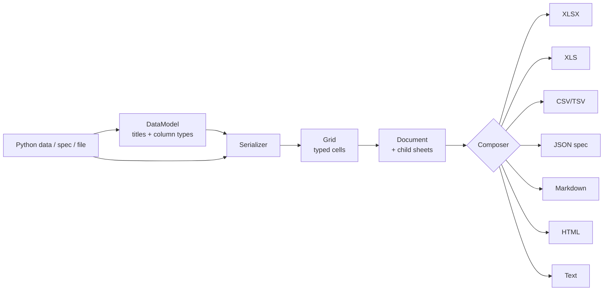

# Concepts

Marmir keeps the architecture of the original library -- the extension points are the
same -- with modern implementations behind them.



Building a document is a two-step process:

1. **Construction** -- `Document(data, ...)` builds a `DataModel` (column titles and
   one field type per column), then a `Serializer` pairs the model with the data and
   returns a populated `Grid` whose every cell is a typed field instance.
2. **Writing** -- `doc.write(...)` / `doc.writestr(...)` runs a `Composer` for the chosen
   format over the document and its children.

## Document

```python
mm.Document(
    data,
    data_model_class=None,   # custom column model (e.g. DjangoDataModel)
    grid_class=None,         # custom grid (e.g. DjangoGrid)
    serializer_class=None,   # custom serializer
    config=None,             # a mm.Config
    config_dict=None,        # dict of option overrides
    order=None,              # column order / titles
    column_types=None,       # {"col": mm.Date} or {"col": "date"}
    name=None,               # sheet name
    **options,               # option overrides, e.g. autofilter=True
)
```

Key members:

| Member | Purpose |
| --- | --- |
| `write(target, format=None)` | Write to a path or file object. |
| `writestr(format=None)` | Return `bytes` (xlsx/xls) or `str` (text formats). |
| `to_bytes(format)` | Always bytes. |
| `to_markdown()`, `to_html()`, `to_csv()`, `to_text()`, `to_json()` | Text renderings. |
| `to_spec()`, `describe()` | Workbook spec / compact summary for LLMs. |
| `rows`, `to_records()`, `columns` | The data back as Python objects. |
| `add_sheet(data, name, **kw)` | Child sheet inheriting options. |
| `add_child(document)`, `set_name(name)` | Legacy multi-sheet API. |
| `set_composer_class(cls_or_name)` | Default composer for `writestr()`. |
| `sheets` | This document plus all nested children, in order. |
| `from_spec()`, `from_file()`, `from_cursor()` | Alternate constructors. |

## DataModel and type inference

`DataModel` normalises the input (see [data sources](data-sources.md)) and decides one
field type per column. It scans the column (all rows by default, or `infer_rows`) and
skips blanks, so a `None` in the first row no longer turns a column into "empty":

- all ints -> integer; ints and floats -> number; any `Decimal` -> decimal
- `datetime` -> datetime, `date` -> date, `time` -> time, `timedelta` -> duration
- strings starting with `=` -> formula (unless `infer_formulas=False`)
- `dict`/`list` values -> JSON text
- mixed types -> string column (cells still keep their own types)

`column_types` overrides inference and coerces values (`"2024-01-31"` becomes a real
date for a `date` column). Values that cannot be coerced are written as their inferred
type with a warning, or raise `DataMismatchError` when `ignore_data_mismatch=False`.

Rows with keys the first row lacks add columns (in first-seen order). Set
`strict_columns=True` for the legacy behaviour of raising instead. Missing keys produce
blank cells.

## Grid and Serializer

`GridBase.populate()` creates `grid_data`, a list of rows of field-type instances.
Override `make_cell()` to change how one value becomes a cell, or `populate()` to read a
different source (as `mm.contrib.django.DjangoGrid` does).

## Field types

| Type name | Class / alias | Python value |
| --- | --- | --- |
| `string` | `mm.Text` (`StringFieldType`) | `str` |
| `integer` | `mm.Integer` | `int` |
| `number` | `mm.Number` (`FloatFieldType`) | `float`/`int` |
| `decimal` | `DecimalFieldType` | `Decimal` |
| `percent` | `mm.Percent(value, decimals=0)` | fraction (`0.25` = 25%) |
| `currency` | `mm.Currency(value, symbol="$", decimals=2)` | number |
| `boolean` | `mm.Bool` | `bool` |
| `date` | `mm.Date(value, format=None)` | `date`/`datetime` |
| `datetime` | `mm.DateTime` | `datetime` (time zones dropped) |
| `time` | `mm.Time` | `time` |
| `duration` | `mm.Duration` | `timedelta` |
| `url` | `mm.URL(url, displayname=None)` | link |
| `image` | `mm.Image(path, width=None, height=None)` | image file |
| `formula` | `mm.Formula("SUM(A1:A3)")` | formula text |
| `empty` | `mm.Empty` | blank |

Every field accepts `style=` and `format=` keyword arguments; `mm.Cell(value, style=...,
format=...)` infers the type for you.

## Composers

A composer renders one format. Built in: `xlsx` (default), `xls`, `csv`, `tsv`, `json`,
`markdown`, `html`, `text`. Register your own:

```python
class MyComposer(mm.ComposerBase):
    format_name = "mine"

    def run(self, child=None):
        return "\n".join(
            ",".join(cell.display() for cell in row) for row in self.grid.grid_data
        )

mm.register_composer("mine", MyComposer, extensions=(".mine",))
doc.write("out.mine")
```

`ComposerBase` still provides the legacy hooks (`write_header`, `iterate_grid`,
`start_new_row`, `write_cell`, `end_row`, `finish`, `set_option`) for cell-by-cell
composers. Helpers in `mm.composers.base` (`cell_style`, `number_format`) give you the
same styling decisions the built-in composers make.

## Configuration

| Option | Default | Meaning |
| --- | --- | --- |
| `headers` | `True` | Write a header row. |
| `freeze_row` / `freeze_col` | `1` / `0` | Frozen rows/columns. |
| `autofilter` | `False` | Filter dropdowns on the header. |
| `adjust_all_col_width` | `True` | Auto-size columns from content. |
| `min_col_width` / `max_col_width` | `6` / `60` | Auto-size limits (characters). |
| `column_widths` | `{}` | Fixed widths by title, index or letter. |
| `header_style` | navy, bold, white | CSS-like header style. |
| `row_styles` | white / light grey | Styles that alternate down the rows. |
| `column_styles` | `{}` | Styles by column. |
| `number_formats` | `{}` | Excel formats by column. |
| `date_format` / `datetime_format` / `time_format` / `duration_format` | `M/D/YY`, `M/D/YY h:mm:ss`, `h:mm:ss`, `[h]:mm:ss` | Default formats. |
| `ignore_data_mismatch` | `True` | Blank cells for missing values instead of raising. |
| `strict_columns` | `False` | Raise when later rows add keys. |
| `infer_formulas` | `True` | Strings starting with `=` are formulas. |
| `infer_rows` | `None` | Rows scanned for type inference (`None` = all). |
| `escape_formula_strings` | `True` | Guard CSV against formula injection. |
| `csv_delimiter` | `,` | CSV delimiter. |
| `max_rows` | `None` | Truncate text renderings (Markdown/HTML/text/JSON). |
| `html_fragment` | `False` | HTML without the page wrapper. |
| `title` / `author` / `description` | `None` | Document properties. |

Legacy spellings such as `INGORE_DATA_MISMATCH` are still accepted, and subclasses of
`ConfigBase` that override options as class attributes keep working.
