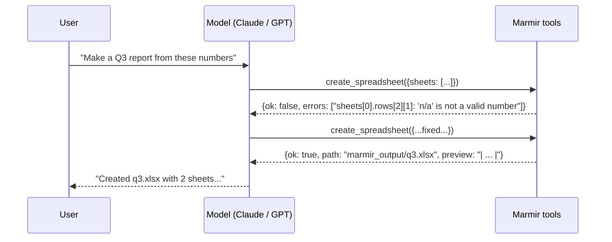

# 5. Let an AI agent build spreadsheets

**Goal:** give Claude or an OpenAI model the ability to create and read spreadsheets,
understand what happens on each turn, and know how to get good results.

## How it works



The model never writes Excel bytes. It writes a [workbook spec](04-workbook-spec.md),
Marmir validates and renders it, and the tool result (including a Markdown preview)
lets the model check its own work.

Three tools are provided:

| Tool | What it does |
| --- | --- |
| `create_spreadsheet` | Validate a spec and write the file (xlsx by default). |
| `preview_spreadsheet` | Validate and return a Markdown preview without writing. |
| `read_spreadsheet` | Read an `.xlsx`/`.xls`/`.csv`/`.json` file as Markdown or JSON. |

## Step 1: drive the tools yourself

Everything a model can do, you can do by calling the tools directly -- the best way to
see what the model will see:

```python
import json

from mm.ai import SpreadsheetTools

tools = SpreadsheetTools(output_dir="marmir_output")

result = tools.call("create_spreadsheet", {
    "title": "Acme Q3",
    "filename": "acme_q3.xlsx",
    "sheets": [{
        "name": "Summary",
        "columns": [{"name": "Customer", "type": "string"}, {"name": "Revenue", "type": "currency"}],
        "rows": [["Union Diner", 1856.25], ["Blue Door Cafe", 1160], ["Total", "=SUM(B2:B3)"]],
    }],
})
print(result["ok"], result["filename"], result["sheets"])
print(result["preview"])
```

Output:

```text
True acme_q3.xlsx [{'name': 'Summary', 'rows': 3, 'columns': ['Customer', 'Revenue']}]
## Summary

| Customer | Revenue |
| --- | ---: |
| Union Diner | $1,856.25 |
| Blue Door Cafe | $1,160.00 |
| Total | =SUM(B2:B3) |
```

Invalid input never raises. It comes back as a list of fixes to make:

```python
bad = tools.call("create_spreadsheet", {
    "sheets": [{"columns": ["Customer", "Revenue"], "rows": [["Union Diner", 1856.25, "extra"]]}],
})
print(bad)
```

Output:

```text
{'ok': False, 'errors': ['sheets[0].rows[0]: has 3 cells but there are 2 columns']}
```

Reading works the same way:

```python
read = tools.call("read_spreadsheet", {"path": "acme_q3.xlsx"})
print(read["content"])
```

Output:

```text
## Summary

| Customer | Revenue |
| --- | --- |
| Union Diner | 1856.25 |
| Blue Door Cafe | 1160 |
| Total | =SUM(B2:B3) |
```

(When reading, Marmir shows stored values -- `1856.25`, not `$1,856.25` -- and formulas
as text, which is what a model needs to reason about the sheet.)

## Step 2: the tool definitions

Each provider wants a slightly different JSON shape; Marmir produces all of them from one
definition:

```python
print([t["name"] for t in tools.anthropic_tools()])        # Anthropic Messages API
print(tools.openai_tools()[0]["type"])                     # OpenAI Responses API
print(list(tools.openai_tools("chat")[0]["function"]))     # OpenAI Chat Completions
```

Output:

```text
['create_spreadsheet', 'preview_spreadsheet', 'read_spreadsheet']
function
['name', 'description', 'parameters']
```

The descriptions teach the model the rules that matter (types, A1 references starting
at row 2, link and style syntax). `marmir tools --provider anthropic` prints them.

## Step 3: Claude

`pip install anthropic` and set `ANTHROPIC_API_KEY`. This is the standard tool-use loop:
send the tools, run every `tool_use` block, return all results in one user message, and
repeat until Claude answers in text.

<!-- skip -->
```python
import anthropic

from mm.ai import SYSTEM_PROMPT, SpreadsheetTools

client = anthropic.Anthropic()
tools = SpreadsheetTools(output_dir="marmir_output")
messages = [{"role": "user", "content": "Build a 12-month cash-flow forecast for a small coffee roaster."}]

while True:
    response = client.beta.messages.create(
        model="claude-opus-5-5",
        max_tokens=16000,
        system=SYSTEM_PROMPT,
        tools=tools.anthropic_tools(),
        messages=messages,
        betas=["server-side-fallback-2026-07-01"],
        fallbacks="default",            # retry a refused request on a fallback model
    )
    if response.stop_reason == "refusal":
        print("Declined.")
        break
    messages.append({"role": "assistant", "content": response.content})
    tool_uses = [block for block in response.content if block.type == "tool_use"]
    if response.stop_reason != "tool_use" or not tool_uses:
        print("".join(block.text for block in response.content if block.type == "text"))
        break
    messages.append({"role": "user", "content": [tools.handle_anthropic_tool_use(b) for b in tool_uses]})
```

`handle_anthropic_tool_use` turns a `tool_use` block into a `tool_result` block, setting
`is_error` when the spec was invalid. You can watch that self-correction without an API
key by feeding it hand-made blocks:

```python
from types import SimpleNamespace

first_try = SimpleNamespace(id="toolu_1", name="create_spreadsheet", input={
    "filename": "forecast.xlsx",
    "sheets": [{"columns": [{"name": "Month", "type": "date"}, {"name": "Cash", "type": "currency"}],
                "rows": [["2025-01-01", "n/a"]]}],
})
result = tools.handle_anthropic_tool_use(first_try)
print(result["is_error"], json.loads(result["content"])["errors"])

second_try = SimpleNamespace(id="toolu_2", name="create_spreadsheet", input={
    "filename": "forecast.xlsx",
    "sheets": [{"columns": [{"name": "Month", "type": "date"}, {"name": "Cash", "type": "currency"}],
                "rows": [["2025-01-01", 12500]]}],
})
result = tools.handle_anthropic_tool_use(second_try)
print(result["is_error"], json.loads(result["content"])["filename"])
```

Output:

```text
True ["sheets[0].rows[0][1]: 'n/a' is not a valid currency (could not convert string to float: 'n/a')"]
False forecast.xlsx
```

## Step 4: OpenAI

`pip install openai` and set `OPENAI_API_KEY`. With the Responses API the loop is:

<!-- skip -->
```python
from openai import OpenAI

from mm.ai import SYSTEM_PROMPT, SpreadsheetTools

client = OpenAI()
tools = SpreadsheetTools(output_dir="marmir_output")
items = [{"role": "user", "content": "Build a 12-month cash-flow forecast for a small coffee roaster."}]

while True:
    response = client.responses.create(
        model="gpt-5", instructions=SYSTEM_PROMPT, tools=tools.openai_tools(), input=items
    )
    items += response.output
    calls = [item for item in response.output if item.type == "function_call"]
    if not calls:
        print(response.output_text)
        break
    items += [tools.handle_openai_tool_call(call) for call in calls]
```

`handle_openai_tool_call` also accepts Chat Completions tool calls (and then returns a
`{"role": "tool", ...}` message), so the same code serves OpenAI-compatible servers such
as Azure OpenAI, vLLM or Ollama.

## Step 5: no code at all -- MCP

For desktop assistants and agent frameworks, run Marmir as an MCP server
(`pip install "marmir[mcp]"`).

**Claude Code:**

```bash
claude mcp add marmir -- uvx --from "marmir[mcp]" marmir-mcp
```

**Claude Desktop** (`claude_desktop_config.json`):

```json
{
  "mcpServers": {
    "marmir": {
      "command": "uvx",
      "args": ["--from", "marmir[mcp]", "marmir-mcp"],
      "env": {"MARMIR_OUTPUT_DIR": "/Users/you/Documents/Marmir"}
    }
  }
}
```

**OpenAI Agents SDK:**

<!-- skip -->
```python
import asyncio

from agents import Agent, Runner
from agents.mcp import MCPServerStdio

from mm.ai import SYSTEM_PROMPT


async def main():
    async with MCPServerStdio(name="marmir", params={"command": "marmir-mcp"}) as server:
        agent = Agent(name="Analyst", instructions=SYSTEM_PROMPT, mcp_servers=[server])
        result = await Runner.run(agent, "Turn sales.csv into a formatted Excel report")
        print(result.final_output)


asyncio.run(main())
```

Then just ask: *"Read ~/Downloads/orders.csv and build a workbook with a summary by
customer and the raw data on a second sheet."*

## Getting good spreadsheets from a model

`mm.ai.SYSTEM_PROMPT` packages the advice that makes the biggest difference. Add it to
your system prompt or agent instructions:

```python
from mm.ai import SYSTEM_PROMPT

print(SYSTEM_PROMPT.splitlines()[0])
```

Output:

```text
When the user wants tabular output (a spreadsheet, table, tracker, budget, report or export), call create_spreadsheet instead of writing a table in chat.
```

In short:

1. **Raw numbers, typed columns.** `0.12` with type `percent`, not `"12%"`; `1250` with
   type `currency`, not `"$1,250"`. The spreadsheet stays calculable.
2. **Formulas for anything derived.** Totals, ratios and running sums as formulas keep
   the sheet live when someone edits a number.
3. **ISO dates.** `"2025-01-31"` -- and a column `format` for display.
4. **Preview first for complex sheets.** `preview_spreadsheet` is cheap; it catches
   off-by-one formula references before a file is written.
5. **Read before you edit.** For "update my spreadsheet" requests, have the model call
   `read_spreadsheet` first.

## Safety defaults

- Files are only written inside `output_dir`; a model-supplied `filename` cannot escape
  it (`"../../etc/x"` becomes `x.xlsx`).
- `read_spreadsheet` only opens files under `read_dirs` (default: the current
  directory) and the output directory.
- Image cells (which reference local files) are off unless `allow_images=True`.
- Specs over `max_cells` (250,000) are rejected.

```python
outside = tools.call("read_spreadsheet", {"path": "/etc/passwd"})
print(outside["errors"][0])
```

Output:

```text
reading '/etc/passwd' is not allowed (outside the permitted directories)
```

More in the [security model](../security.md).

## Recap

- `SpreadsheetTools` gives any model `create_spreadsheet`, `preview_spreadsheet` and
  `read_spreadsheet`, with provider-specific definitions and handlers.
- Errors go back to the model as fix-it lists; the model corrects itself.
- MCP (`marmir-mcp`) connects Claude Desktop, Claude Code and the OpenAI Agents SDK
  without code.

Next: [6. A spreadsheet API for GPTs and apps](06-http-api.md).
